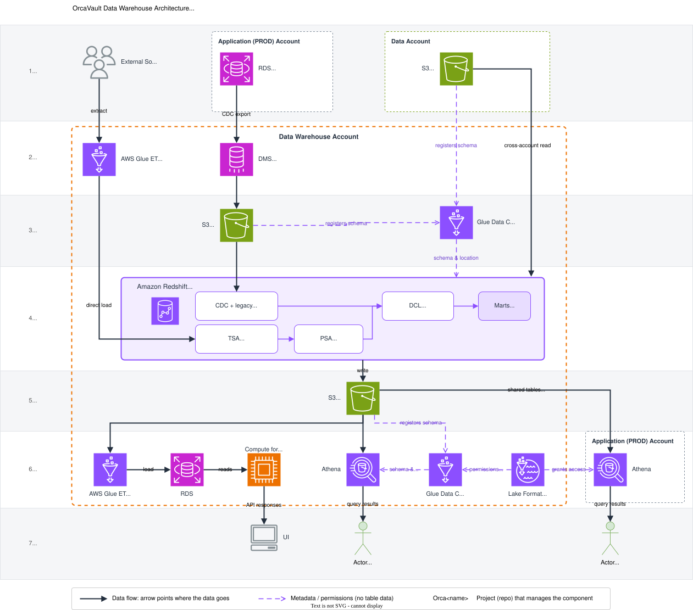

# OrcaHouse Documentation

- **Website**: [https://umccr.github.io/orcahouse-doc](https://umccr.github.io/orcahouse-doc)
- **GitHub**: [https://github.com/umccr/orcahouse-doc](https://github.com/umccr/orcahouse-doc)
- **Description**: Documentation for [OrcaHouse](https://github.com/umccr/orcahouse)

OrcaHouse is the data warehouse project for UMCCR. [OrcaBus](https://github.com/umccr/orcabus) keeps only the data its services need to run, such as executing tasks. OrcaHouse consolidates that data with other sources, tracks its history, and makes it useful for analysis, reporting and audit. This repository holds the documentation only. The code lives in the [repositories below](#the-orcahouse-repositories).

## Architecture at a glance

> Source: [warehouse_design.drawio](arch/assets/warehouse_design.drawio). More diagrams (system design, data flow, data layers) are in the [architecture note](arch).

## The OrcaHouse repositories

| Repository                                              | Role                                                                                    |
| ------------------------------------------------------- | --------------------------------------------------------------------------------------- |
| [orcahouse](https://github.com/umccr/orcahouse)         | Architecture and infrastructure as code (IaC) for the whole project.                    |
| [orcavault](https://github.com/umccr/orcavault)         | Data transformation: the SQL queries and transformation logic that build the warehouse. |
| [orcaglue](https://github.com/umccr/orcaglue)           | AWS Glue services: frontline ETL that brings upstream data into the warehouse.          |
| [orcanexus](https://github.com/umccr/orcanexus)         | Data API: the logic that serves warehouse data.                                         |
| [orcahouse-doc](https://github.com/umccr/orcahouse-doc) | This repository: documentation.                                                         |

## Where to start

| I want to...                                  | Go to                                                         |
| --------------------------------------------- | ------------------------------------------------------------- |
| Understand the data flow and warehouse layers | [Architecture](arch)                                          |
| Query the warehouse with SQL                  | [OrcaHouse Athena](athena) and its [examples](athena/example) |
| Browse tables, columns and relationships      | [ERD guide](erd) / [OrcaVault ERD](erd/orcavault)             |
| Explore models and lineage                    | [dbt guide](dbt) / [OrcaVault dbt docs](dbt/orcavault)        |
| Look up a term                                | [Glossary](glossary.md)                                       |

## FAQ

### What is OrcaHouse?

OrcaHouse is the project. The project comprises Enterprise Data Warehouses (EDW). The term "OrcaHouse" kept as high level project concept.

### What is the high level architecture?

OrcaHouse mainly follows implementation of "[Enterprise Data Warehouse](https://www.google.com/search?q=Enterprise+Data+Warehouse)" architecture. Alternate would be "[Data LakeHouse](https://www.google.com/search?q=LakeHouse+architecture)" architecture. There are subtle differences in how you approach to data modelling based on the architecture choice being made.

### What is OrcaVault?

OrcaVault is the first EDW of OrcaHouse. Its main goal is to build the data warehouse need of our upstream [OrcaBus](https://github.com/umccr/orcabus) system.

### What problem OrcaVault solve?

As mentioned, our upstream [OrcaBus](https://github.com/umccr/orcabus) system is based on "Event-driven" "Microservice" architecture. The system comprises many smaller-sized transactional databases. These microservices may come and go (being replaced) as it pivots to new business requirement. OrcaVault EDW aims to capture, consolidate, observe, archive and history track these changes. Provide business intelligence and audit trail. For more details, refer to [README](erd).

### What is data flow looking like?

Please read the high-level [architecture note](arch) to understand the overall data flow and data layers within the warehouse.

### What is the federated query interface looking like?

Federated query is possible via [OrcaHouse Athena](athena) setup.

### What is a mart?

A mart is a set of tables built for a specific consumer or use case, downstream of the data consolidation layer (DCL). Consumers query the mart rather than the upstream layers.
